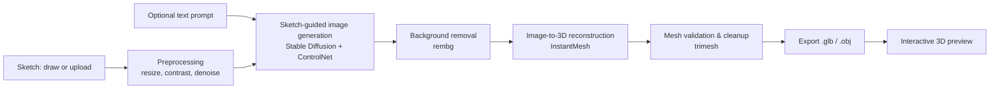

# Tech-zypher4
<div align="center">

# ✏️ ➜ 🧊 Sketch2Shape AI

### From a rough 2D sketch to a textured, exportable 3D asset


**Team TEAM_NAME** · Built in 24 hours at **TechZephyr 4.0, IIT Bhubaneswar**

[Quick Start](#-quick-start-for-judges) · [Demo](#-demo) · [Architecture](#-system-architecture) · [Setup](#-installation--setup) · [Results](#-sample-results) · [Limitations](#-limitations) · [Team](#-team)

</div>

---

## 📖 Table of Contents

1. [Quick Start for Judges](#-quick-start-for-judges)
2. [Problem Statement](#-problem-statement)
3. [Our Solution](#-our-solution)
4. [Key Features](#-key-features)
5. [Demo](#-demo)
6. [System Architecture](#-system-architecture)
7. [Models & Third-Party Components Used](#-models--third-party-components-used)
8. [Tech Stack](#-tech-stack)
9. [Hardware, Runtime & Performance](#-hardware-runtime--performance)
10. [Installation & Setup](#-installation--setup)
11. [Running the Application](#-running-the-application)
12. [Inputs & Outputs](#-inputs--outputs)
13. [Sample Results](#-sample-results)
14. [Mesh Validation](#-mesh-validation)
15. [Project Structure](#-project-structure)
16. [Limitations](#-limitations)
17. [Troubleshooting](#-troubleshooting)
18. [Future Scope](#-future-scope)
19. [Team](#-team)
20. [Acknowledgements & Licenses](#-acknowledgements--licenses)

---

## ⚡ Quick Start for Judges

> The shortest path from clone to a generated 3D file.

```bash
git clone https://github.com/USERNAME/REPO_NAME.git
cd REPO_NAME
conda create -n sketch2shape python=3.10 -y && conda activate sketch2shape
pip install -r requirements.txt
python scripts/download_weights.py      # downloads all model weights
python app.py                           # opens the app at http://127.0.0.1:7860
```

Then either **draw a sketch** on the canvas or **upload an image**, optionally add a text prompt, and click **Generate 3D**. The result appears in the 3D viewer and is saved to `outputs/` as a `.glb` file.

**Command-line alternative (no UI):**

```bash
python generate.py --input examples/inputs/chair.png --prompt "wooden chair" --output outputs/chair.glb
```

| Item | Value |
|------|-------|
| Tested on | _GPU model, VRAM, RAM, OS_ |
| Typical generation time | _X seconds / minutes per model_ |
| Internet needed? | _Only for first-time weight download (or: no, weights bundled)_ |
| Pre-generated examples | `examples/outputs/` |

---

## 🎯 Problem Statement

Turning an idea into a 3D digital asset normally requires specialised skills in modelling, texturing, and rendering. A hand-drawn sketch is often the first expression of an idea, but it carries limited information about depth, volume, proportions, and unseen geometry.

**Challenge:** build a functional application that accepts a **single-view 2D sketch** (drawn in-app or uploaded), optionally guided by a **text prompt**, and converts it into a **visually compelling, textured 3D model** that keeps the structure and recognisable character of the original concept, and exports it as `.glb` or `.obj`.

**Potential applications:** product design and prototyping, architecture and interior design, animation, VFX and gaming, 3D printing, education and creative exploration.

---

## 💡 Our Solution

Sketch2Shape AI is an end-to-end pipeline that chains computer vision, generative AI, and 3D reconstruction:

1. The sketch is **cleaned and conditioned** (resize, contrast, noise removal, edge/scribble extraction).
2. A **sketch-guided diffusion model** generates a refined, product-style image that stays faithful to the sketch's structure, steered by the optional text prompt.
3. The **background is removed** to isolate the object.
4. A **pretrained image-to-3D model** reconstructs textured geometry.
5. The mesh is **validated and exported** to `.glb` / `.obj`, and previewed in an interactive 3D viewer.

**In short:** sketch in, textured 3D asset out, with no manual modelling.

---

## ✨ Key Features

- ✏️ **In-app drawing canvas** with brush, eraser, and reset
- 🖼️ **Image upload** for existing sketches (PNG / JPG / JPEG)
- 💬 **Optional text prompt** for material, colour, and style (never required)
- 🎛️ **Sketch-faithful generation** using ControlNet-style structural conditioning
- 🧹 **Automatic preprocessing** and background removal
- 🧊 **Real 3D geometry** with textures, not a flat plane or rendered image
- 👀 **Interactive 3D preview** to rotate and inspect the model
- 💾 **One-click export** to `.glb` and/or `.obj`
- ✅ **Built-in mesh validation** (non-empty geometry, file re-opens correctly)
- 🖥️ **CLI mode** for reproducible, scriptable runs

_Add or remove items to match what you actually shipped._

---

## 🎬 Demo

| Resource | Link |
|----------|------|
| 🎥 Demo video | _add link_ |
| 📊 Presentation | _add link_ |
| 🌐 Live app (optional) | _add link_ |
| 📓 Notebook (Colab/Kaggle, optional) | _add link_ |


---

## 🏗️ System Architecture



### Stage-by-stage explanation

| Stage | What happens | Why this choice |
|-------|--------------|-----------------|
| **1. Input & conditioning** | Canvas or upload is resized, binarised or contrast-adjusted, denoised; edges/scribbles are extracted | Gives the diffusion model a clean structural signal |
| **2. Sketch-guided generation** | Diffusion model produces a refined product-style image constrained by the sketch | Keeps output related to the sketch instead of drifting to a text-only result |
| **3. Image preparation** | Foreground isolated, background removed, object centred | Image-to-3D models work best on clean single-object inputs |
| **4. 3D reconstruction** | Pretrained image-to-3D model estimates geometry and texture | Fast, high-quality single-image reconstruction |
| **5. Validation & export** | Mesh checked, cleaned, saved as `.glb` / `.obj` | Guarantees a usable, openable file |

> ⚠️ _Update the diagram and table to match the exact models and steps you finally used._

---

## 🧩 Models & Third-Party Components Used

> As required by the hackathon rules, all pretrained models, external APIs, and third-party components are disclosed here.

| Component | Purpose | Source | License |
|-----------|---------|--------|---------|
| Stable Diffusion _(version)_ | Base image generation | [Hugging Face](https://huggingface.co/) | _check model card_ |
| ControlNet _(scribble / canny)_ | Sketch-structure conditioning | [Hugging Face](https://huggingface.co/) | _check model card_ |
| rembg _(model name)_ | Background removal | [GitHub](https://github.com/danielgatis/rembg) | MIT |
| InstantMesh | Image-to-3D reconstruction | [TencentARC/InstantMesh](https://github.com/TencentARC/InstantMesh) | _check repo_ |
| trimesh | Mesh validation and export | [trimesh.org](https://trimesh.org/) | MIT |
| Gradio / Streamlit | User interface | _link_ | Apache-2.0 / Apache-2.0 |

**External APIs / services:** _None. Everything runs locally._ (or list them)

**Model-weight access:** _Weights are downloaded automatically by `scripts/download_weights.py` from Hugging Face. No login or token is required._ (or explain any token needed)

**Training:** We use pretrained models only; no models were trained from scratch during the hackathon. _(Update if you fine-tuned anything.)_

---

## 🛠️ Tech Stack

| Category | Tools |
|----------|-------|
| Language | Python 3.10 |
| Deep learning | PyTorch, Hugging Face Diffusers, Transformers |
| Computer vision | OpenCV, Pillow, rembg |
| 3D processing | trimesh, _PyMeshLab / Open3D (if used)_ |
| Interface | Gradio _(or Streamlit)_ |
| 3D viewer | Gradio `Model3D` / three.js `<model-viewer>` |

---

## 🖥️ Hardware, Runtime & Performance

> Judges asked for hardware assumptions and generation time. Fill this in with real measurements.

### Hardware used for development and testing

| Item | Spec |
|------|------|
| GPU | _e.g. NVIDIA RTX 3060 12 GB / Colab T4 16 GB_ |
| VRAM | _GB_ |
| CPU / RAM | _…_ |
| OS | _Ubuntu 22.04 / Windows 11_ |
| CUDA / PyTorch | _CUDA 12.1 / PyTorch 2.x_ |

### Time to generate one 3D model

| Stage | Time (approx.) |
|-------|----------------|
| Preprocessing | _s_ |
| Sketch-guided image generation | _s_ |
| Background removal | _s_ |
| 3D reconstruction | _s_ |
| Mesh validation and export | _s_ |
| **Total** | **_s_** |

### Resource usage

- **Peak VRAM:** _GB_
- **Disk space for weights:** _GB_
- **Minimum recommended hardware:** _…_
- **CPU-only support:** _Yes (very slow) / No_

---

## ⚙️ Installation & Setup

### Prerequisites

- Python **3.10**
- Git
- NVIDIA GPU with CUDA recommended (_min VRAM_ GB)
- ~_X_ GB free disk space for model weights

### Step-by-step

```bash
# 1. Clone
git clone https://github.com/USERNAME/REPO_NAME.git
cd REPO_NAME

# 2. Create environment
conda create -n sketch2shape python=3.10 -y
conda activate sketch2shape

# 3. Install PyTorch (match your CUDA version: https://pytorch.org/get-started/locally/)
pip install torch torchvision --index-url https://download.pytorch.org/whl/cu121

# 4. Install remaining dependencies
pip install -r requirements.txt

# 5. Download model weights
python scripts/download_weights.py
```

### Environment variables / configuration

| Variable | Purpose | Default |
|----------|---------|---------|
| `HF_HOME` | Where Hugging Face caches weights | `~/.cache/huggingface` |
| `DEVICE` | `cuda` or `cpu` | auto-detect |
| _add more_ | | |

### Verify installation

```bash
python scripts/check_setup.py
```

_Expected output: all checks passed (GPU found, weights present, dependencies importable)._

---

## ▶️ Running the Application

### Option A: Web UI (recommended)

```bash
python app.py
```

Open **http://127.0.0.1:7860** and follow the three steps:

1. **Provide a sketch:** draw on the canvas or upload an image
2. **(Optional)** type a prompt, for example _"matte red ceramic teapot"_
3. Click **Generate 3D**, then inspect the model and download the `.glb` / `.obj`

### Option B: Command line

```bash
python generate.py \
  --input examples/inputs/chair.png \
  --prompt "wooden chair, oak texture" \
  --output outputs/chair.glb \
  --format glb
```

| Argument | Description | Required |
|----------|-------------|----------|
| `--input` | Path to sketch image | ✅ |
| `--prompt` | Text prompt for style/material | ❌ |
| `--output` | Output file path | ✅ |
| `--format` | `glb` or `obj` | ❌ (default `glb`) |
| `--seed` | Random seed for reproducibility | ❌ |

---

## 📥 Inputs & Outputs

**Inputs**

- Sketch: drawn in-app or uploaded (`.png`, `.jpg`, `.jpeg`); recommended: dark strokes on a light background, single object
- Prompt: optional free text

**Outputs**

- `outputs/<name>.glb` (and/or `.obj` + `.mtl` + texture) with real 3D geometry and textures
- Intermediate images (generated reference image, background-removed image) saved in `outputs/<name>_intermediate/`

**Opening the exported file:** drag the `.glb` into [Blender](https://www.blender.org/), [gltf-viewer.donmccurdy.com](https://gltf-viewer.donmccurdy.com/), or the Windows 3D Viewer.

---

## 🖼️ Sample Results

| Input Sketch | Prompt | Generated Image | 3D Output (preview) | File |
|--------------|--------|-----------------|---------------------|------|
|  | _"…"_ |  |  | [`sample1.glb`](examples/outputs/sample1.glb) |
|  | _"…"_ |  |  | [`sample2.glb`](examples/outputs/sample2.glb) |
|  | _(no prompt)_ |  |  | [`sample3.glb`](examples/outputs/sample3.glb) |

**Observations:** _what worked well, what did not, and why._

---

## ✅ Mesh Validation

Every generated asset is checked before it is offered for download:

- [x] File opens successfully with `trimesh`
- [x] Geometry is non-empty (vertex and face count > 0)
- [x] Mesh is a 3D volume, not a flat plane (bounding-box depth check)
- [x] Textures / materials preserved in the exported file
- [ ] _Mesh is watertight (optional)_

```bash
python scripts/validate_mesh.py outputs/chair.glb
```

---

## 📁 Project Structure

```
REPO_NAME/
├── app.py                    # Web UI entry point
├── generate.py               # CLI entry point
├── requirements.txt          # Pinned dependencies
├── src/
│   ├── preprocess.py         # Resize, contrast, denoise, edge extraction
│   ├── sketch_to_image.py    # Diffusion + ControlNet generation
│   ├── background.py         # Background removal
│   ├── image_to_3d.py        # Image-to-3D reconstruction
│   ├── mesh_utils.py         # Validation, cleanup, export
│   └── config.py             # Central configuration
├── scripts/
│   ├── download_weights.py   # Fetch model weights
│   ├── check_setup.py        # Environment sanity check
│   └── validate_mesh.py      # Mesh validation CLI
├── examples/
│   ├── inputs/               # Sample sketches
│   ├── intermediate/         # Generated reference images
│   └── outputs/              # Sample .glb / .obj files
├── assets/                   # README images, demo GIF
├── docs/                     # Extra documentation
├── LICENSE
└── README.md
```

_Update to match your real layout._

---

## ⚠️ Limitations

Being upfront about limits is part of good engineering. Known limitations:

- **Hidden geometry is inferred.** A single-view sketch does not define the back or underside of an object, so those surfaces are plausible estimates, not exact.
- **Very rough or ambiguous sketches** may be interpreted differently from the user's intent.
- **Thin structures** (wires, handles, spokes) and fine details may be lost or merged.
- **Complex multi-object scenes** are not supported; the pipeline expects a single main object.
- **Runtime depends on GPU.** _On CPU, generation takes about X minutes._
- **Not production-grade topology.** Output is not manufacturing-ready for 3D printing, engineering-grade for architecture, or animation-ready.
- **Pretrained model biases.** Results inherit the strengths and weaknesses of the underlying models.
- _Add any issues you actually faced while generating models._

---

## 🩺 Troubleshooting

| Problem | Likely cause | Fix |
|---------|--------------|-----|
| `CUDA out of memory` | Not enough VRAM | Lower image resolution in `src/config.py`, enable half precision, or close other GPU apps |
| `torch.cuda.is_available()` is `False` | CPU-only PyTorch or driver issue | Reinstall PyTorch matching your CUDA version |
| Weights fail to download | No internet or Hugging Face rate limit | Retry, or set `HF_HOME` and download manually; see `docs/manual_weights.md` |
| Output is a flat plane or empty mesh | Poor background removal or low-contrast sketch | Use darker strokes on a plain background; retry with a different seed |
| Output does not match sketch | Prompt overpowering the sketch | Shorten the prompt or reduce prompt strength |
| `.glb` has no texture in viewer | Viewer limitation | Open in Blender or another glTF viewer |
| Port 7860 already in use | Another app running | `python app.py --port 7861` |

_Add the real errors you hit during development. Judges value this._

---

## 🔮 Future Scope

- [ ] Multi-view generation for better hidden geometry
- [ ] Mesh simplification and retopology for games and animation
- [ ] Watertight, print-ready export for 3D printing
- [ ] Style presets and material library
- [ ] Interactive refinement (edit sketch, regenerate)
- [ ] Faster inference with model optimisation

---

## 👥 Team

**Team Name:** TEAM_NAME

| Name | Role | GitHub | LinkedIn |
|------|------|--------|----------|
| Member 1 | _e.g. ML pipeline_ | [@username](https://github.com/username) | [Profile](#) |
| Member 2 | _e.g. 3D reconstruction and export_ | [@username](https://github.com/username) | [Profile](#) |
| Member 3 | _e.g. UI and integration_ | [@username](https://github.com/username) | [Profile](#) |
| Member 4 | _e.g. Documentation and testing_ | [@username](https://github.com/username) | [Profile](#) |

---

## 🙏 Acknowledgements & Licenses

- **TechZephyr 4.0, IIT Bhubaneswar** for organising the hackathon and the problem statement
- [Hugging Face Diffusers](https://huggingface.co/docs/diffusers/main/en/using-diffusers/controlnet), [InstantMesh](https://github.com/TencentARC/InstantMesh), [rembg](https://github.com/danielgatis/rembg), and [trimesh](https://trimesh.org/) and their authors

This project's code is released under the **MIT License** (see [LICENSE](LICENSE)). Pretrained models and third-party libraries remain under their own licenses, listed in the [components table](#-models--third-party-components-used).

---

<div align="center">

⭐ If you found this useful, give it a star! ⭐

Made with ❤️ by **TEAM_NAME** at **TechZephyr 4.0, IIT Bhubaneswar**

</div>
